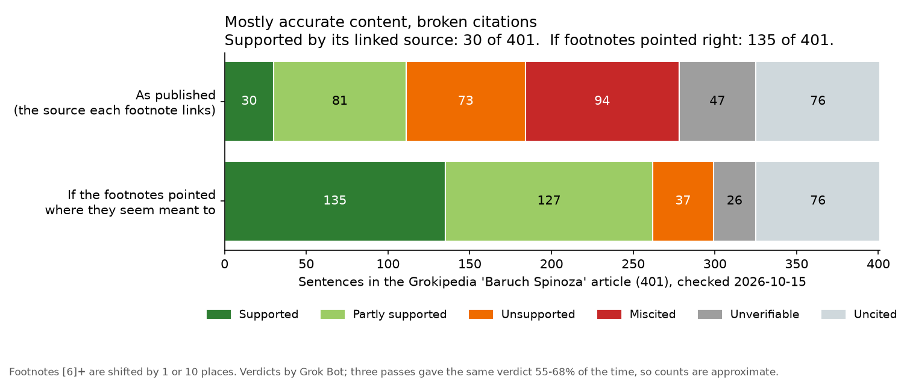

# Topic: Spinoza

A sentence-by-sentence check of the citations and facts in the Grokipedia article on Baruch Spinoza, from snapshots saved on 2026-10-01 and 2026-10-15. Back to the [repo README](../../README.md).

## Status: rebuilding (superseded by [Update 2026-10-15](#update-2026-10-15) below)

There are no current results for this topic yet. The October 2026 audit below was made before the switch to the plain method described in the repo README, and it will be redone with that method.

The earlier audit found that from citation [90] onward the article's citation numbers appear to be shifted by nine places, so many footnotes point to the wrong source. Anyone can check this directly against the snapshot. Its other counts were model judgments under the retired workflow and shouldn't be quoted as current. The report is kept as a record: [spinoza_audit.md](articles/baruch-spinoza/analyses/2026-10-01/spinoza_audit.md).

## What's in this folder

| Path | What it holds |
|---|---|
| [ARTICLE_LIST.md](ARTICLE_LIST.md) | The article audited, with snapshot and live-page links |
| `articles/baruch-spinoza/snapshots/` | Saved copy of the article (`2026-10-01.html` as fetched, `2026-10-01.md` as readable text) |
| `articles/baruch-spinoza/analyses/2026-10-01/` | Earlier audit, retired method (record only): the audit report (`spinoza_audit.md`), the per-sentence log (`spinoza_audit_log.csv`) and its inputs (`data/`) |
| `articles/baruch-spinoza/snapshots/2026-10-15.{html,md}` | Fresh snapshot used by the current run |
| [articles/baruch-spinoza/analyses/2026-10-15/](articles/baruch-spinoza/analyses/2026-10-15/README.md) | Current run: per-sentence log, rechecks, corrections, method |
| `articles/baruch-spinoza/edit_submissions/` | Correction drafts for Grokipedia (none yet) |

There is no `runs/` folder: this topic has a single-article audit and no cross-article scan runs yet. The earlier audit was done with [tools/grokaudit](../../tools/grokaudit/README.md).

```
me: why is the necessary? Why should this be necessary when we have these massive teams of brain jars with access to all of the worlds data? Elon cannot afford a clean copy of Ethics to stash in the grokipedia library? these AI companies scraped the ENTIRE black market for digital books RIGHT before they shut down libgen forever. coincidence? They could at least return the books to the public so their AI systems can make accurate references. this is GREEEEEEED.
```

## Update 2026-10-15

A new run checks a fresh snapshot (2026-10-15) with the plain method: [run README](articles/baruch-spinoza/analyses/2026-10-15/README.md). Flags are leads for a human to check, not final verdicts.



Two bars for the same 401 sentences: as linked, and with the footnote shift undone. "Mostly accurate content" in the chart title is the assistant's reading, not a measured label.

**Counts (401 sentences)**

| Verdict | as linked | footnote shift undone |
|---|---:|---:|
| supported | 30 | 135 |
| partly supported | 81 | 127 |
| unsupported | 73 | 37 |
| miscited | 94 | — |
| unverifiable | 47 | 26 |
| uncited | 76 | 76 |

Ethics claims checked against the pinned Elwes text: 82 match in content, 8 do not match, 47 concern other works with no primary text on hand.

**Footnote offset.** The shift found on 2026-10-01 is still there and has grown. A new inline [5] was added to the end of the list, so inline [6]–[90] now point one place too high and [91] and up point ten places too high. Inline [154]–[162] point past the end of the 153-entry list. See [OFFSET.md](articles/baruch-spinoza/analyses/2026-10-15/OFFSET.md). 400 of 401 sentences are unchanged since 2026-10-01 ([DIFF.md](articles/baruch-spinoza/analyses/2026-10-15/DIFF.md)).

**Named errors** (each with the source's words in [RECHECK.md, section 4](articles/baruch-spinoza/analyses/2026-10-15/RECHECK.md) and the row in [claim_log.csv](articles/baruch-spinoza/analyses/2026-10-15/data/claim_log.csv)):
- C120: burial placed near Grotius; the source has "close to the grave of Johan de Witt".
- C368: a 1678 papal condemnation; no cited source supports it, and the source has "banned by the States of Holland".
- C383: Einstein's "Spinoza's God" line called an interview; the source gives it as his reply to Rabbi Herbert S. Goldstein.
- C173, C177: 2 + 2 = 4 given as Spinoza's example; the Elwes text has "the fourth proportional is six".
- C209: a virtue quote cited to E4P37; it is in the E4P18 note.
- Others (C043, C064, C108, C118, C123, C158, C199, C201, C291, C313) are listed in the same section.

**Repeat rates.** The verdicts were checked three times by Grok Bot sessions of the same model kind, not independent people, and the checks were not blind. The same verdict came up in 55–68% of rows, so the fine counts above are approximate. The footnote offset, the named errors and the 8 Ethics mismatches held up in every check. Details: [run README](articles/baruch-spinoza/analyses/2026-10-15/README.md#repeat-rates), [CORRECTIONS.md](articles/baruch-spinoza/analyses/2026-10-15/CORRECTIONS.md).
